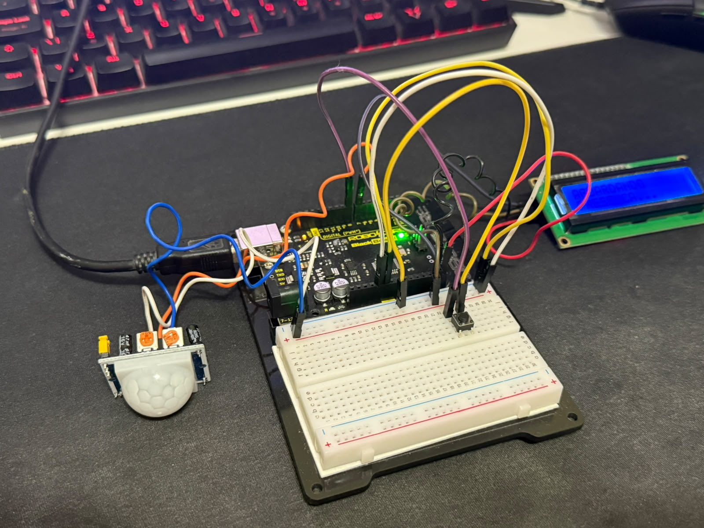
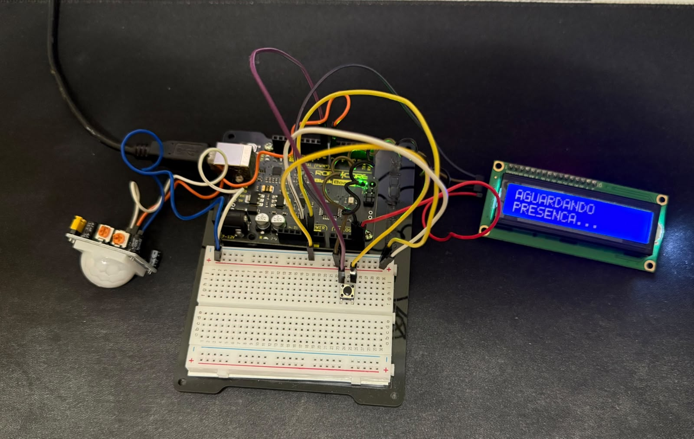

# Quem Faz Smart Point — FIAP Global Solution 2026.2

Protótipo didático de dispositivo físico integrado a um backend local do **Quem Faz**, plataforma de conexão entre cidadãos que precisam de serviços e profissionais que buscam oportunidades em São Paulo.

## Demonstração e montagem

[Assista ao vídeo demonstrativo do Quem Faz Smart Point](video/Quem_Faz_Maker.mp4)





**Fluxo real deste repositório:** PIR detecta movimento → botão inicia gravação → microfone do computador captura voz → Vosk (modelo de IA para fala) transcreve → classificador de aprendizado de máquina classifica a solicitação → LCD exibe categoria → cidadão confirma com botão → API local registra pedido em SQLite → LCD mostra ID da solicitação.

> **Limites honestos:** o dispositivo não fala sozinho nem tem reconhecimento de fala embarcado no Arduino. O computador executa os modelos. A API registra pedidos localmente; **não há distribuição, notificação ou contratação de profissionais reais**. A integração com o MVP definitivo do Quem Faz poderá substituir o endpoint local. O desafio da matéria cita explicitamente a *evolução de um robô anterior*: se nenhum robô foi construído antes, validar com o professor a aceitação deste protótipo de mesa antes da entrega.

## 0. Pré-requisitos

- Arduino UNO R3; protoboard; cabo USB; sensor PIR; botão momentâneo; LCD 16x2 **I²C de quatro pinos**; fios jumper. Buzzer opcional.
- Computador **Windows**, com microfone funcional, Arduino IDE 2.x e Python **3.12** (testado com 3.12.10); crie o ambiente `.venv` seguindo as instruções abaixo.
- Acesso à internet **uma vez** para baixar as dependências e o modelo Vosk. Após o download, a transcrição e a classificação rodam localmente.
- Antes de energizar, confira orientações `VCC`, `GND`, `OUT` de cada componente. Não confie na ordem física dos pinos sem verificar sua serigrafia.

## 1. Ligue o LCD ao Arduino, com o USB desconectado

### LCD I²C — ligações reais

| LCD | Arduino UNO |
|---|---|
| GND | GND |
| VCC | 5V |
| SDA | A4 |
| SCL | A5 |

Instale **hd44780 by Bill Perry** no Gerenciador de Bibliotecas da Arduino IDE. Os sketches usam `hd44780_I2Cexp`, com identificação automática do endereço do módulo. Ajuste o contraste no trimpot do adaptador I²C, se necessário.

Para testar o LCD, conecte também o PIR e o botão conforme a seção seguinte e carregue o firmware principal. Se só mostrar quadradinhos, ajuste o trimpot e confira VCC/GND/SDA/SCL.

## 2. Conecte PIR e botão, com USB desconectado

| Componente | Terminal | Arduino |
|---|---|---|
| PIR | VCC | 5V |
| PIR | OUT | D7 |
| PIR | GND | GND |
| Botão momentâneo | uma perna | D8 |
| Botão momentâneo | perna do outro lado elétrico | GND |
| Buzzer opcional | + | D9 |
| Buzzer opcional | − | GND |

O botão usa **INPUT_PULLUP**: solto = HIGH; pressionado = LOW. Em botões de 4 pernas, duas pernas do mesmo lado podem estar conectadas permanentemente. Escolha duas que se conectam **somente ao pressionar**. Confira com teste de continuidade, quando possível.

O PIR frequentemente precisa de **30–60 segundos de estabilização**. Seu tempo de retenção pode variar. Ele detecta movimento, não garante presença contínua de pessoa parada.

No firmware principal, a tela `PRESENCA OK / APERTE BOTAO` espera 15 segundos pelo primeiro clique. Para ajustar, altere `TEMPO_PRESENCA_MS` no sketch e carregue-o novamente. Se o sinal do PIR ainda estiver ativo ao término, o Arduino pode detectar presença novamente e voltar a exibir a mensagem.

Após carregar o firmware principal, aguarde a estabilização do PIR e movimente a mão diante do sensor. O LCD deve mostrar `PRESENCA OK / APERTE BOTAO`. A execução completa é descrita na seção 7.

## 3. Carregue o programa completo do Arduino

Na Arduino IDE, selecione **Ferramentas → Placa → Arduino Uno** e a porta COM da placa. Abra `arduino/quem_faz_smart_point/quem_faz_smart_point.ino`, clique em **Verificar** e depois em **Carregar**. Feche o Monitor Serial ao concluir — ele disputa a porta COM com o Python.

Os estados do LCD são: aguardando → presença → gravando → processando → categoria/confirmar → registrando → pedido registrado (ou erro).

**Correção de integração (15/11/2026):** foi corrigido um erro de temporização que podia encerrar a gravação imediatamente após o primeiro clique. É necessário **carregar o firmware atualizado na placa**. Diagnóstico, alterações, limitações e roteiro de validação estão em [docs/validacao_integracao.md](docs/validacao_integracao.md).

## 4. Prepare o Python (PowerShell, dentro da pasta do projeto)

```powershell
py -3.12 -m venv .venv
.\.venv\Scripts\Activate.ps1
python -m pip install --upgrade pip
pip install -r requirements-dev.txt
```

Se o PowerShell bloquear a ativação, abra **Prompt de Comando (cmd.exe)** e use `.venv\Scripts\activate.bat`, ou execute o Python via `.venv\Scripts\python.exe` sem ativar.

Se `.venv` já existir e funcionar, preserve o ambiente. Todos os comandos também podem usar `.\.venv\Scripts\python.exe` diretamente. Habilite o acesso ao microfone para aplicativos da área de trabalho no Windows.

### Baixar o modelo de reconhecimento de fala

```powershell
python scripts/baixar_modelo.py
```

Baixa o `vosk-model-small-pt-0.3`, um modelo leve de português brasileiro de aproximadamente 31 MB comprimido. O arquivo extraído fica em `models/vosk-model-small-pt-0.3/`. Não suba modelos grandes ao GitHub. O download é feito do projeto oficial Vosk.

### Testar IA sem hardware

```powershell
python -m app.demo --texto "Minha torneira está vazando e preciso de um encanador"
python -m pytest -q
```

O terminal deve imprimir a categoria `HIDRAULICA`; os testes automatizados devem passar. O classificador usa TF-IDF de caracteres + regressão logística, treinado com **frases didáticas e sintéticas** (`app/dataset.py`). Ele pode errar ou solicitar nova fala quando a confiança é baixa. Para um serviço de produção, aumente o conjunto de dados e avalie com dados reais autorizados.

O limiar mínimo da ponte permanece **0,26**. A confiança exibida pertence ao classificador, não mede a precisão do Vosk. Os testes usam serial e áudio simulados e banco temporário; não substituem a validação física.

### Teste do microfone separado do Arduino

Antes de conectar a placa ao Python, você pode confirmar que o reconhecimento de fala funciona:

```powershell
python -m app.testar_voz
```

Aperte ENTER para começar, fale uma solicitação e aperte ENTER para parar. A transcrição e a categoria aparecerão no terminal. Esse teste requer o modelo Vosk baixado e o microfone liberado pelo Windows.

## 5. Inicie o backend (terminal 1)

No Windows, uma alternativa é clicar duas vezes em `iniciar_smart_point.bat`, na raiz do projeto. Ele abre duas janelas: backend e ponte serial. Mantenha ambas abertas e acesse `http://127.0.0.1:8000`. A porta configurada é **COM3**; se a placa estiver em outra porta, edite `PORTA_ARDUINO` no arquivo `.bat`. Feche o Monitor Serial antes de iniciar a ponte.

```powershell
python -m uvicorn app.api:app --host 127.0.0.1 --port 8000
```

Visite `http://127.0.0.1:8000` e confirme que aparece o painel Quem Faz Smart Point. O endpoint de saúde está em `http://127.0.0.1:8000/health`.

**Teste do backend sem Arduino**, em outro terminal com ambiente virtual ativo:

```powershell
python -m app.demo --texto "Preciso de um eletricista para trocar uma tomada" --salvar
```

Atualize o painel; o pedido deve aparecer. Dados ficam em `data/solicitacoes.sqlite3` (ignorado no Git).

O teste por texto registra origem `demo_texto`; a ponte registra `smart_point_voz`. Cada pedido classificado pela ponte recebe chave de idempotência, evitando duplicidade em retransmissões. O banco antigo é migrado automaticamente sem apagar registros.

## 6. Localize microfone e porta COM (terminal 2)

```powershell
python -m app.voice
python -m serial.tools.list_ports
```

O primeiro comando lista microfones e dispositivos de áudio; o segundo mostra portas COM. Escolha a porta conectada ao Arduino. Não deixe o Monitor Serial da Arduino IDE aberto ao executar a ponte.

## 7. Execute a integração completa (terminal 2)

Exemplo: substitua `COM3` pela porta do seu computador.

```powershell
python -m app.bridge --porta COM3
```

Se o microfone padrão não funcionar, use o índice correto: `python -m app.bridge --porta COM3 --mic 1`.

### Demonstração prática

1. Espere o PIR estabilizar (~30 s após energizar/reiniciar).
2. Passe a mão em frente ao PIR → LCD `PRESENCA OK / APERTE BOTAO`.
3. Pressione botão **uma vez** → LCD `GRAVANDO VOZ / BOTAO = PARAR`.
4. Fale claramente ao microfone do **computador**: "Preciso de um encanador para trocar uma torneira que está vazando".
5. Pressione o botão **pela segunda vez** → LCD `PROCESSANDO / AGUARDE...`.
6. O terminal mostra transcrição e categoria, e o LCD mostra a categoria identificada.
7. Revise a categoria e pressione o botão **pela terceira vez** para confirmar.
8. O backend registra o pedido. O LCD mostra `PEDIDO REGISTR. / ID <numero>`.
9. Abra `http://127.0.0.1:8000` para visualizar o pedido recém-criado.

Para testar outra categoria, espere o retorno ao estado inicial ou pressione botão depois de ver o resultado.

**Importante:** se a transcrição ficar vazia ou a classificação tiver baixa confiança, o LCD exibe erro, sem registrar pedido. A captação ocorre **somente após pressionar o botão**. A gravação é descartada em memória após transcrição; apenas o texto reconhecido e a categoria são registrados no SQLite local.

## 8. Problemas comuns

| Sintoma | Causa provável / ação |
|---|---|
| LCD com quadrados | ajustar trimpot do adaptador I²C, revisar SDA=A4 e SCL=A5 |
| LCD apagado | verificar 5V/GND, adaptador I²C e biblioteca hd44780 |
| Gravação termina imediatamente após o primeiro clique | recarregar o firmware corrigido; havia uso de horário anterior à mudança de estado, causando estouro na subtração sem sinal |
| PIR sem resposta | conferir VCC/OUT/GND, esperar 30–60 s e gerar movimento |
| Botão pressionado sem efeito | revisar contato de lados diferentes, estado `PRESENCA OK` e D8/GND |
| `PermissionError: COM3` | fechar Monitor Serial e outras aplicações que ocupem a porta |
| `Could not open COM3` | revisar porta com `python -m serial.tools.list_ports` |
| `PortAudioError` | verificar microfone padrão/privacidade do Windows/índice com `python -m app.voice` |
| Erro de modelo ausente | executar `python scripts/baixar_modelo.py` |
| Texto de voz incorreto | reduzir ruído, falar perto do microfone; Vosk pequeno pode errar |
| `ERRO NO PEDIDO / SERVIDOR` | iniciar `uvicorn` e testar `/health` |
| Nunca aparece `PEDIDO REGISTR.` | não houve confirmação ou backend não respondeu com sucesso |
| Falha ao instalar pacotes Python | usar Python 3.11/3.12, atualizar pip, conferir arquitetura 64 bits |

## 9. Arquitetura e privacidade

O PIR detecta movimento e o Arduino habilita a interação. O primeiro clique envia `EVENT:START_RECORD` pela serial; o segundo envia `EVENT:STOP_RECORD`. A ponte Python captura áudio PCM mono a 16 kHz, o Vosk transcreve a fala e o classificador TF-IDF com regressão logística estima a categoria. A ponte envia `CLASSIFIED:<categoria>` ao Arduino para exibição no LCD. Após o clique de confirmação (`EVENT:CONFIRM`), a ponte chama a API local e só envia `RESULT:OK:<id>` quando o backend confirma o registro. Em caso de falha, envia uma mensagem de erro. O [diagrama de fluxo](docs/diagrama.mmd) detalha as etapas.

As categorias disponíveis são **hidráulica, elétrica, pintura, limpeza, montagem e informática**. Serviços fora dessas categorias podem ser classificados incorretamente; confira a categoria antes de confirmar.

- Comunicação Arduino/PC: USB serial 115200 baud (sem ESP8266).
- Reconhecimento de fala: Vosk offline.
- Classificação por IA: TF-IDF + regressão logística (`scikit-learn`), treinada com frases sintéticas criadas para esta PoC.
- Persistência: FastAPI + SQLite **somente localhost**.
- Segurança: não expor o servidor publicamente; o protótipo não possui autenticação para uso real.
- Privacidade: não falar dados pessoais durante os testes; não armazenar arquivos de áudio; transcrição escrita no SQLite local. Para uso público, desenvolver consentimento, autenticação, retenção e proteção de dados conforme LGPD.
- Integração futura ao produto principal: alterar URL/contrato do backend para a API real do Quem Faz, com confirmação de usuário e autenticação apropriada. Só então será correto dizer que houve publicação real para profissionais.

## 10. Entregáveis da disciplina

- O [vídeo demonstrativo](video/Quem_Faz_Maker.mp4) e as fotos da montagem estão disponíveis neste repositório.
- Completar a lista de integrantes e RMs antes da entrega.
- Validar com o professor **antes da entrega** a adequação do assistente físico estacionário à exigência de *evoluir robô desenvolvido anteriormente* e qual seria o "sensor adicional" diante da ausência de um robô prévio.

### Integrantes

> Substituir pelos nomes e RMs definitivos antes de subir ao GitHub. Este arquivo não inventa integrantes.

### ODS relacionados (a justificar na entrega)

**ODS 10 — Redução das desigualdades** e **ODS 11 — Cidades e comunidades sustentáveis**, como potencial de acesso inclusivo a serviços e oportunidades na cidade de São Paulo. Indicadores sugeridos: pedidos registrados, taxa de classificação correta, tempo médio para registrar pedido, percentual de solicitações que exigem repetição.

## Referências públicas

- [Biblioteca hd44780 — Bill Perry](https://github.com/duinoWitchery/hd44780)
- [Vosk — modelos para português](https://alphacephei.com/vosk/models)
- [PySerial — primeiros passos](https://www.pyserial.org/docs/getting-started)
